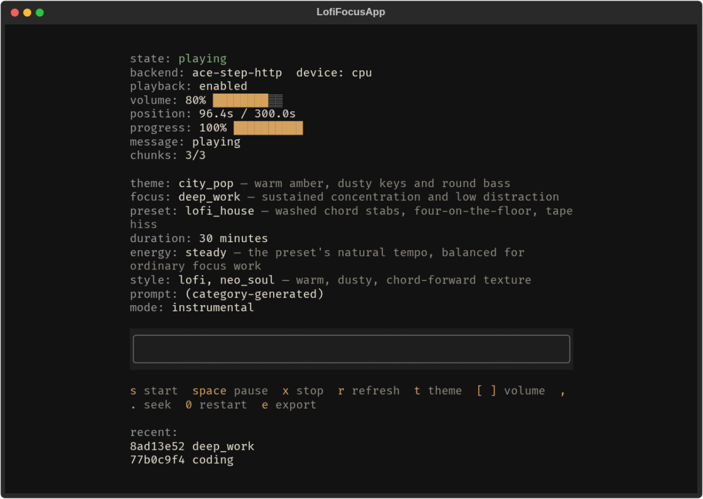

# Lofi Focus TUI

Session-first terminal UI for AI-generated focus music.



The app owns prompt planning, ACE-Step integration, device selection, continuity checks,
playback state, and cache in one process. The normal backend is ACE-Step over HTTP; mock
mode is an explicit development fallback.

## Install and run

The normal setup uses the ACE-Step-1.5 service already running remotely at
`192.168.2.220:8001`. The Lofi app runs locally as a single process; do not start
ACE-Step on the Lofi machine.

You need Python 3.10+, Git, and [`uv`](https://docs.astral.sh/uv/) if you also manage the
ACE-Step service.

### 1. Install Lofi Focus TUI

```bash
cd ~/Documents
git clone https://github.com/Csavoldi/lofi-focus-tui.git
cd lofi-focus-tui
python3 -m venv .venv
source .venv/bin/activate
python -m pip install -e ".[playback]"
```

If you already have the repository, just change into it and activate `.venv`.

### 2. Configure the remote ACE-Step service

Create a local, git-ignored configuration file:

```bash
cd ~/Documents/lofi-focus-tui
source .venv/bin/activate
cp config.example.toml config.toml
```

Make sure `config.toml` contains the following settings:

```toml
[generation]
backend = "ace-step-http"
inference_steps = 8
guidance_scale = 7.0
batch_size = 1
chunk_seconds = 600

[ace_step_http]
base_url = "http://192.168.2.220:8001"
api_key = ""
timeout_seconds = 1800.0
```

If your ACE-Step service is on a different machine, replace `192.168.2.220` with its
LAN address. Keep port `8001` reachable from the machine running Lofi, and do not expose
the ACE-Step API directly to the public internet.

Check the remote service before launching the app:

```bash
curl http://192.168.2.220:8001/health
curl http://192.168.2.220:8001/v1/models
```

### 3. Start the app

```bash
cd ~/Documents/lofi-focus-tui
source .venv/bin/activate
lofi
```

The app is ready when it shows `backend: ace-step-http` and `message: ready`. Press `2`
until the duration says `5 minutes`, then press `s` to generate and play a song. The
first generation can take a few minutes. Generated audio is saved under
`~/.cache/lofi-focus-tui/outputs`.

Press `e` after generation to export the WAV and metadata. The default export directory
is `~/Music/lofi-focus-tui`.

### TUI controls

```text
i       edit the free-form prompt
v       toggle instrumental or vocal mode
s       start a session
space   pause or resume
x       stop
r       refresh status
1       change focus
p       change music preset
2       change duration
3       change energy
4       change style
t       change theme
[       lower volume
]       raise volume
,       rewind 10 seconds
.       forward 10 seconds
0       restart current audio
e       export audio and metadata
h       open option guide
Escape  stop editing the prompt or close the guide
q       quit
```

Focus, music preset, energy, style, and the free-form prompt are separate choices. The
prompt engine combines them into an ACE-Step prompt while leaving room for custom text.

Music comes from nine genre presets: `classic_lofi`, `neo_soul`, `ambient_tape`,
`jazz_vinyl`, `lofi_house`, `synthwave`, `city_pop`, `boom_bap`, and `peaceful_piano`.
Each preset carries its own tempo range — energy picks the soft, natural, or livelier
end of it — and ten prompt variations with different lead sounds, drum feels, and
basslines. The session seed picks the variation, so the same seed reproduces the same
take while new sessions explore the pool. Style tags such as `rainy, mellow` or
`neon, retro` layer extra texture over any preset.

See [`docs/usage.md`](docs/usage.md) for the full option lists and guide behavior.

### The quality loop

A built-in producer loop scores every generated session and adjusts prompts to
fix what each take got wrong:

- **Scoring:** a 60-second excerpt is rated with
  [AudioBox Aesthetics](https://github.com/facebookresearch/audiobox-aesthetics)
  (PQ/CE/CU/PC, 1–10, human-rater trained), plus loudness-envelope
  measurements (`dip_ratio`, `sustained_fraction`) computed locally on every
  track. The status line shows the result during playback:
  `playing · quality PQ 8.2`.
- **Auto refinement:** weak takes (CE/CU/PQ below 6.0, or dip/bed thresholds
  crossed) are regenerated with escalated prompt wording and a fresh seed
  *before* you hear them; the best attempt is the one saved and played.
- **Next-session adjustment:** the scored report feeds adjustment phrases into
  the next session's caption, so the prompt keeps improving run over run.

Enable it in `config.toml`:

```toml
[quality]
backend = "audiobox"
auto_refine = true
max_refinement_attempts = 2   # total takes per session (2 = one retry)
```

The repo's `config.example.toml` ships `backend = "none"`, which still records
the envelope measurements but scores nothing. With `backend = "audiobox"` but
the `audiobox_aesthetics` package missing, reports degrade to envelope-only —
sessions never fail because of analysis. Install it with
`uv pip install --python .venv/bin/python audiobox_aesthetics requests` when
you want scores. `scripts/tune_prompts.py` runs the same engine offline to
tune preset words; `scripts/listen.py` A/B-compares any set of saved takes.

Full guide: [`docs/quality-loop.md`](docs/quality-loop.md).

### Troubleshooting

- **ACE-Step health check fails:** verify that the remote service is running at
  `192.168.2.220:8001`, that the Lofi machine can reach it, and that the firewall allows
  TCP port `8001`.
- **The app shows the wrong backend:** check `config.toml`, or run
  `LOFI_BACKEND=ace-step-http lofi` for a one-off override.
- **No sound:** the generated WAV is still saved. Confirm that an audio output device is
  available and that the `[playback]` extra was installed.
- **A request times out:** leave `timeout_seconds = 1800.0` and check the ACE-Step service
  logs. Five-minute generation can take several minutes on the remote GPU.

For advanced configuration and diagnostics, see [`docs/configuration.md`](docs/configuration.md),
[`docs/ace-step.md`](docs/ace-step.md), and the `lofi-doctor` command documented in
[`docs/usage.md`](docs/usage.md).

## Development

```bash
python3 -m venv .venv
source .venv/bin/activate
python -m pip install -e ".[dev,playback]"
```

The app reads `config.toml` from the repository directory, then from
`~/.config/lofi-focus-tui/config.toml`. `config.toml` is git-ignored, so local settings
such as LAN IPs and API keys stay out of the repository.

Run the local checks:

```bash
ruff check src tests
pytest -q
```

### Mock mode

Mock mode does not require ACE-Step and runs in the same single-process app:

```bash
LOFI_BACKEND=mock lofi
```

Press `s` to start a mock session. Run diagnostics with:

```bash
lofi-doctor
```

Saved sessions are written under `~/.cache/lofi-focus-tui/outputs`, with history at
`~/.cache/lofi-focus-tui/history.jsonl`.

## ACE-Step-1.5 HTTP smoke test

The live UAT uses the remote ACE-Step service and verifies a five-minute request:

```bash
LOFI_UAT_ACE_STEP_BASE_URL=http://192.168.2.220:8001 \
LOFI_UAT_ACE_STEP_SECONDS=300 \
pytest tests/test_live_ace_step_http.py -v
```

Use the fake-pipeline tests for normal development. Run the live test only when the
remote ACE-Step service is available.

More detail:

- [Usage](docs/usage.md)
- [Configuration](docs/configuration.md)
- [Quality loop](docs/quality-loop.md)
- [ACE-Step modes](docs/ace-step.md)
- [User acceptance testing](docs/user-acceptance-testing.md)
